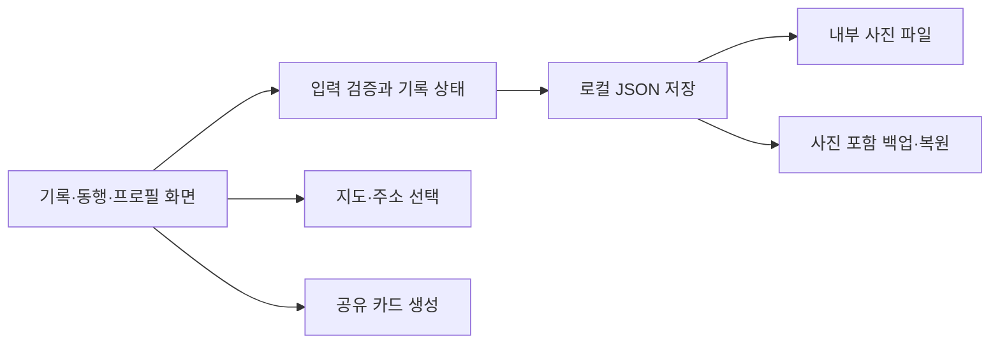

# 그때그곳

**장소에 사람과 이야기를 더하는 나의 맛집 지도.**

맛있었던 메뉴뿐 아니라 누구와 갔는지, 어떤 이야기를 나눴는지 함께 남기는 Android 앱입니다. 방문한 곳과 다음에 함께 가고 싶은 곳을 사람별 앨범과 지도로 다시 찾아봅니다.

이 저장소는 **초기 개발 버전의 구조·개발 기록·선별한 Kotlin 예제**를 공개합니다. 전체 앱을 빌드하는 프로젝트는 포함하지 않습니다. 문서 기준일: 2026-10-27.

## 사용하는 흐름

1. 내 프로필과 함께 다니는 사람의 별명·관계·사진을 등록합니다.
2. 방문한 곳 또는 가고 싶은 곳을 저장하고 지도에서 위치를 고릅니다.
3. 날짜·동행·메뉴·지출·사진·메모를 한 기록에 모읍니다.
4. 사람별 앨범, 검색, 지도로 기록을 다시 찾습니다.
5. 이름과 메모의 포함 여부를 고른 뒤 이미지 카드로 공유합니다.

## 화면 구성

| 영역 | 사용자가 하는 일 |
|---|---|
| 기록 | 방문 기록 검색·필터·수정, 사진과 메모 열람 |
| 사람별 앨범 | 연인·친구·가족 등 동행별 추억 확인 |
| 가고 싶은 곳 | 다음 약속에 갈 장소 보관 |
| 지도 | 기록 위치 확인, 지도에서 위치 선택 |
| 프로필·데이터 관리 | 기기 내 프로필 편집, 사진 포함 백업·복원 |

크림색 바탕, 자주색 글자, 귤색 포인트와 사진 티켓 형태를 사용했습니다. 많은 장소를 평가하는 서비스보다 개인의 기록을 다시 펼쳐 보는 경험에 집중했습니다.

## 구현한 범위

- 방문/희망 장소, 여러 동행, 태그, 재방문 의사, 사진 최대 8장
- 서버 가입 없이 기기 안에서 만드는 내 프로필과 동행 프로필
- OpenStreetMap·Leaflet 지도, Android Geocoder 주소 검색, 선택적 현재 위치
- 외부 지도 연결, Android 공유 시트를 이용한 이미지 카드 전달
- 로컬 JSON과 AtomicFile 저장, 사진을 포함하는 ZIP 백업·복원

지도와 주소 검색은 인터넷이 필요합니다. Geocoder는 기기에 따라 장소명 검색 결과가 제한됩니다. 지도 타일 제공자의 이용 정책과 서비스 규모는 별도로 검토해야 합니다. 실시간 공동 편집과 온라인 친구 계정은 현재 범위에 포함하지 않았습니다.

## 구조 둘러보기



| 문서 | 내용 |
|---|---|
| [앱 구조](docs/ARCHITECTURE.md) | 실제 소스 역할, 저장·지도·공유 흐름 |
| [개발 과정](docs/DEVELOPMENT.md) | 기획에서 구현으로 이어진 결정과 초기 버전의 한계 |
| [Kotlin 예제](examples/MemoryExamples.kt) | 동행 연결, 좌표 검증, 공유 문구 선택의 축약 예제 |
| [검증 범위](docs/VALIDATION.md) | 공개 예제 실행과 원본 앱 검증의 구분 |
| [공개 범위](PUBLIC_SCOPE.md) | 포함·제외 항목, 권리와 기여 안내 |

## 기술

Kotlin / Android Views / Android 7.0 이상 / AtomicFile / Android Geocoder / WebView / Leaflet / OpenStreetMap / FileProvider.

지도 라이브러리와 지도 데이터의 권리는 각 제공자에게 있습니다. 이 저장소에 해당 라이브러리의 소스나 타일을 복제하지 않았습니다.

## 예제 실행

JDK 17 이상과 Kotlin/JVM 컴파일러가 설치된 환경에서 저장소 루트에서 실행합니다.

```sh
kotlinc examples/MemoryExamples.kt -include-runtime -d /tmp/there-then-examples.jar
java -jar /tmp/there-then-examples.jar
```

Windows에서는 출력 경로를 임시 디렉터리의 `.jar` 경로로 바꾸면 됩니다. Android SDK나 API 키가 필요하지 않습니다. 예제는 가상 데이터만 사용하며 제품의 저장 형식·전체 UI·복원 코드를 포함하지 않습니다.

관련 프로젝트: [차곡 : 주유부터 정비까지](https://github.com/SilnoonE/chagok-android-showcase)
