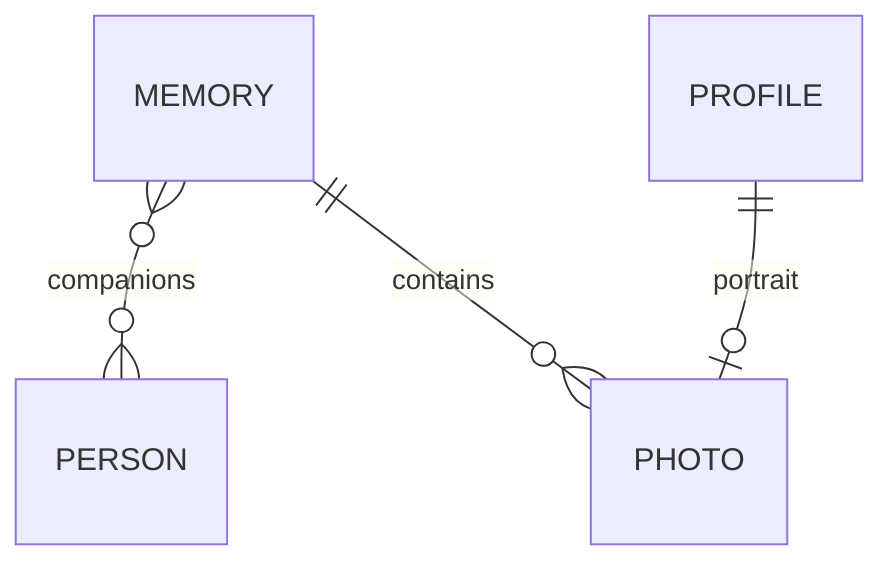
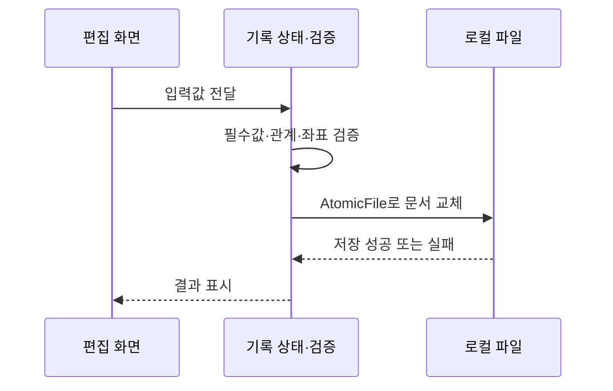

# 초기 버전 앱 구조

실제 프로젝트를 읽어 정리한 2026-10-27 스냅샷입니다. 아래 이름은 모듈의 역할을 설명하며, 이 저장소에는 원본 클래스 전체가 들어 있지 않습니다.

## 역할별 구성

| 원본 파일 | 책임 |
|---|---|
| MainActivity.kt | 화면 진입, 기록·사람·프로필 편집과 사용자 동작 연결 |
| AlbumUi.kt | 앨범 화면의 시각 요소와 공통 UI |
| Models.kt | 프로필·동행·기록 모델, 문서 검증, 로컬 저장 |
| MediaFiles.kt | 선택한 사진 처리, 백업 생성·복원 |
| MapActivity.kt | 지도 표시, 주소 검색, 좌표 선택 |
| PolicyActivity.kt | 앱 내 정책 안내 |

현재는 작은 초기 버전으로 화면 코드와 기능 연결이 가깝게 배치되어 있습니다. 대규모 모듈 분리나 MVVM을 구현했다고 표현하지 않습니다. 화면이 늘어나면 편집 상태와 파일 입출력 경계를 더 분리할 여지가 있습니다.

## 기록과 사람의 관계

동행은 기록 안에 이름 문자열을 중복 저장하는 대신 식별자로 연결합니다. 한 기록에 여러 명을 선택할 수 있고, 사람 이름을 바꿔도 연결 관계를 유지할 수 있습니다. 개인 프로필과 동행 프로필은 기기 안의 정보이며 서버 계정이 아닙니다.

## 저장 흐름

기록은 로컬 JSON, 사진은 내부 파일로 보관합니다. 문서 쓰기에 AtomicFile을 사용하고, 원본 문서를 읽지 못한 상태에서 무작정 새 기록으로 덮어쓰지 않도록 처리했습니다. 이 방식이 모든 장애나 여러 파일의 원자성을 보장하는 것은 아닙니다.

사진 백업에는 문서뿐 아니라 참조된 사진이 필요합니다. 복원은 임시 영역에서 내용을 검증한 뒤 적용하며 파일 경로·중복 항목·크기 등을 검사합니다. 원본 복원 알고리즘과 상세 백업 스키마는 공개하지 않습니다.

## 지도와 공유

지도 화면은 WebView 안의 Leaflet과 OpenStreetMap을 사용합니다. Android Geocoder로 주소를 찾고 선택한 좌표를 기록에 붙입니다. 현재 위치는 사용자가 요청할 때 사용하는 보조 기능이며 이동 경로를 자동 수집하는 기능은 없습니다.

공유는 기록을 이미지 카드로 만든 뒤 FileProvider와 Android 공유 시트로 전달합니다. 동행 이름과 메모는 공유할 때 포함 여부를 고릅니다. 공유받는 사람의 앱 가입은 필요하지 않습니다.

## 공개 예제와의 관계

[MemoryExamples.kt](../examples/MemoryExamples.kt)는 관계 연결과 공유 선택을 이해할 수 있도록 새 이름과 가상 데이터로 다시 작성했습니다. Android 렌더링, FileProvider 설정, 실제 JSON 키, 사진 파일 규칙은 포함하지 않았습니다.
