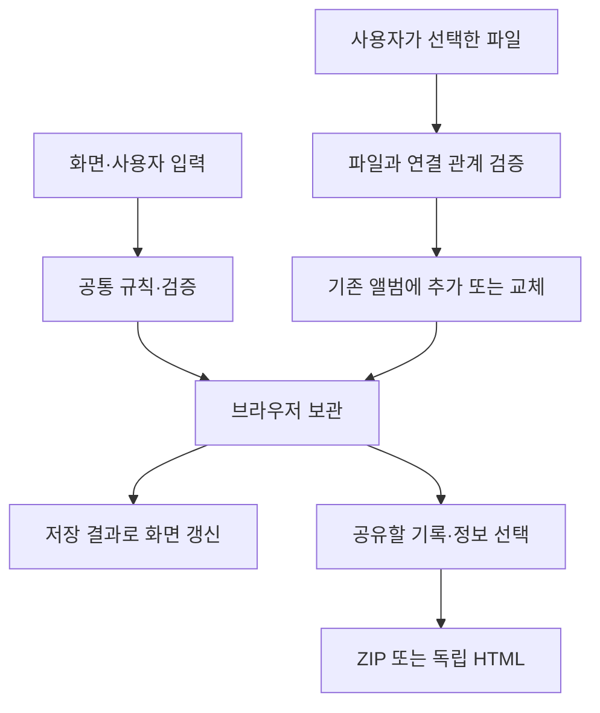

# 웹 구조 개요

2026-10-27의 개발 상태를 기준으로 역할과 데이터 흐름을 정리했습니다. 원본 소스와 상세 저장 형식은 포함하지 않습니다.

## 역할 나누기

| 영역 | 책임 |
|---|---|
| 화면과 입력 | 기록·동행·약속·편지 편집, 검색, 선택 공유 |
| 공통 규칙 | 입력 검증, 날짜 판단, 예산·시간에 맞는 약속 생성 |
| 브라우저 보관 | 기록과 사진을 저장하고 저장 성공 후 화면 갱신 |
| 파일 입출력 | 백업 읽기·검증, 추가·교체, 공유 파일 만들기 |
| 지도 표시 | 저장 좌표 표시와 사용자 위치 선택 |

현재는 작은 웹 앱에 맞춰 역할별 ES 모듈로 나누었습니다. 프레임워크와 서버 계정을 먼저 붙이기보다 기본 기록과 파일 왕복이 동작하는 데 집중했습니다.

## 파일을 추가할 때

불러온 데이터를 확인한 뒤 사용자가 추가 또는 교체를 고릅니다. 추가는 현재 프로필과 기록을 유지하며, 가져온 항목의 식별자와 사진 연결이 기존 항목과 충돌하지 않도록 다룹니다. 교체는 현재 앨범 전체가 달라지는 작업이므로 별도로 안내합니다.

기록·동행·사진·약속·캡슐·기념일의 연결이 함께 유지되어야 합니다. 원본 기록을 삭제하더라도 캡슐에서 사용하는 사진은 남겨야 합니다. 상세한 병합 알고리즘과 백업 스키마는 이 자료에서 제외했습니다.

## 보관과 공유를 구분하기

전체 백업은 앨범을 보존하기 위한 파일입니다. 선택 공유는 다른 사람이 볼 항목만 골라 만드는 파일입니다. 두 기능이 같은 이름으로 보이면 개인 편지나 메모까지 잘못 전달할 수 있어 별도 흐름으로 구성했습니다.

공유 HTML에는 선택한 글과 사진을 포함하고 실행 스크립트를 넣지 않았습니다. 사용자가 입력한 문자열을 HTML에 그대로 끼워 넣지 않는 원칙을 적용했습니다. [짧은 예제](examples/public-sharing.mjs)는 이 선택 원칙만 보여 줍니다.

## 현재 한계

브라우저의 사이트 데이터를 지우면 로컬 앨범이 사라질 수 있어 백업이 필요합니다. 앱·웹 자동 동기화, 서버에 보관하는 공개 앨범 링크, 서버에서 보장하는 캡슐 개봉 시각은 현재 범위에 포함하지 않습니다.
