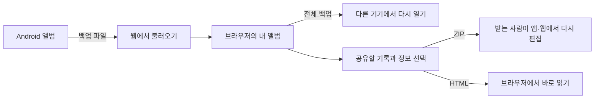

# 그때그곳 웹 개발 기록

**앱의 기록을 웹에서도 펼치고, 함께한 순간을 파일로 나누기.**

그때그곳 Android 앱에 이어 웹 버전을 개발하고 있습니다. 방문한 곳뿐 아니라 누구와 함께했는지, 다음에는 무엇을 하고 싶은지, 미래의 우리에게 어떤 이야기를 남길지를 한 앨범에 모읍니다.

2026-10-27 기준으로 기본 기능을 구현하고 **소유자용 비공개 미리보기 배포**를 완료했습니다. 일반 공개와 도메인 연결은 후속 단계입니다. 이 폴더는 개발 과정을 설명하는 자료이며 전체 서비스 소스가 아닙니다.

## 웹에서 구현한 기능

| 기능 | 사용자 흐름 |
|---|---|
| 기록·사진 | 장소·날짜·메뉴·지출·메모와 사진을 작성·수정하고 검색 |
| 함께한 사람 | 기기 안에서 사용하는 동행 프로필과 관계 분류 |
| 장소 지도 | 저장한 장소 확인, 지도에서 기록 위치 선택 |
| 오늘의 약속 뽑기 | 동행·총예산·가능 시간·분위기로 활동 코스를 뽑고 확정 |
| 추억 타임캡슐 | 편지와 사진, 개봉일을 저장하고 약속한 날 다시 읽기 |
| 오늘의 우편함 | 지난 해 같은 날의 기록과 기념일에 연결한 추억 확인 |
| 파일 가져오기 | 앱의 사진 포함 백업 또는 사진 없는 문서를 읽고 추가·교체 |
| 파일로 공유하기 | 선택한 기록만 ZIP 또는 HTML 앨범으로 만들기 |

## 파일을 중심으로 연결하기

파일 불러오기는 브라우저 안에서 처리합니다. 앨범을 서버에 업로드하거나 앱과 웹을 자동으로 동기화하는 방식은 아닙니다.

- **전체 백업 ZIP**: 프로필·기록·약속·캡슐·기념일과 참조된 사진을 보관합니다.
- **공유 ZIP**: 선택한 기록을 받은 사람이 다시 불러올 수 있는 앨범으로 전달합니다.
- **공유 HTML**: 글과 사진이 들어 있는 독립적인 읽기용 앨범입니다. 파일 자체를 브라우저로 열 수 있습니다.

이름·메모·주소와 좌표는 기본 공유에서 제외하고, 사용자가 직접 포함 여부를 고릅니다. 전체 백업에는 아직 개봉하지 않은 편지도 포함되므로 부분 공유와 구분했습니다.

## 시각 구성

앱의 크림색 바탕, 자주색 글자, 귤색 포인트를 이어갔습니다. PC에서는 사이드 메뉴와 앨범·보조 카드를 배치하고, 작은 화면에서는 하단 메뉴로 이동합니다. 식탁과 편지봉투는 코드로 그린 그림을 사용했습니다.

## 기술과 현재 범위

HTML·CSS·JavaScript ES 모듈, IndexedDB, Leaflet·OpenStreetMap, JSZip을 사용합니다. 웹 버전은 정적 자산으로 구성하고 기록과 사진은 브라우저에 보관합니다. 외부 라이브러리 원본은 이 공개 자료에 복제하지 않았습니다.

타임캡슐은 기기의 날짜에 따라 화면에서 내용을 숨기는 기능입니다. 별도 암호화나 서버 시간 검증은 제공하지 않습니다. 웹의 우편함은 페이지를 열 때 날짜를 확인하며 브라우저를 닫아둔 동안 알림을 보내지는 않습니다.

## 공개 자료

- [구조와 처리 흐름](ARCHITECTURE.md)
- [개발과 업로드 과정의 개요](DEVELOPMENT.md)
- [검증한 범위](VALIDATION.md)
- [선별한 JavaScript 예제](examples/public-sharing.mjs)

예제는 가상 데이터로 공유 원칙을 설명하도록 새로 작성했습니다. 제품의 실제 데이터 키·백업 스키마·파일 처리와 배포 내부 구현은 공개하지 않습니다. 권리와 사용 범위는 저장소의 [공개 범위](../PUBLIC_SCOPE.md)를 따릅니다.
